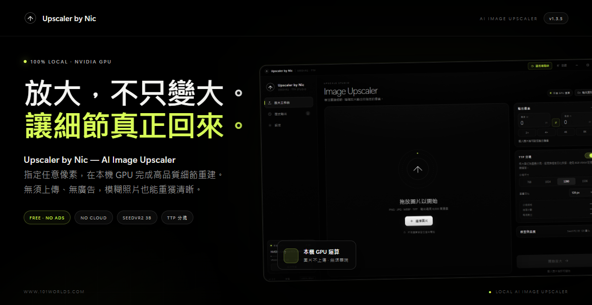
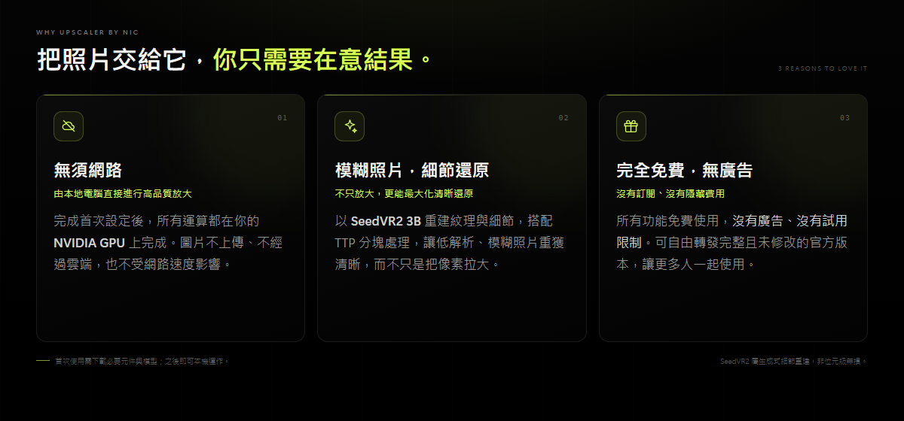

  

  

<h1 align="center">Upscaler by Nic — AI Image Upscaler</h1>

  <strong>把圖片放大，也把模糊照片的細節找回來。</strong> 
  在本機 GPU 完成高品質細節重建 · 免費 · 無廣告 · 圖片不上傳

  

  Windows 10 / 11 x64 · v1.3.5 · 約 108 MB 
  <a href="https://github.com/nickyvan101/enlarge/releases/latest">最新版本與更新紀錄</a>
  &nbsp;·&nbsp;
  <a href="https://www.101worlds.com">官方網站</a>
  &nbsp;·&nbsp;
  <a href="https://www.101worlds.com/sponsor.html">請我喝咖啡</a>

---

  

## 三大特色

### 1. 無須網路，由本地電腦直接進行高品質圖片放大

完成首次元件下載後，所有放大運算都在你的電腦與 NVIDIA GPU 上進行。圖片不會上傳，也不需要連上雲端；沒有網路也能繼續使用。

### 2. 不只放大，更能將模糊照片最大化清晰還原

以 SeedVR2 3B 重建紋理與細節，搭配 TTP 分塊羽化處理，讓低解析、模糊照片重獲清晰，而不是單純把像素拉大。你可以直接指定輸出的精確像素尺寸。

### 3. 完全免費、無廣告

所有功能免費使用，沒有廣告、沒有訂閱、沒有隱藏費用。可自由轉發完整且未修改的官方版本；禁止轉售、付費散布與修改。

## 開始使用

1. 下載並安裝 **Upscaler by Nic**。
2. 載入圖片，指定想要的輸出寬度與高度。
3. 按「開始放大」，在本機 GPU 完成處理並輸出 PNG / JPEG / WebP。

> 首次使用需要下載 SeedVR2 引擎、Python / PyTorch 執行環境與模型（約 7GB）；下載完成後即可本機運作，之後更新程式不會重複下載。移除程式時也會詢問是否保留這些元件。

## 下載

| 項目 | 內容 |
| --- | --- |
| 最新版本 | **v1.3.5** |
| 安裝檔 | [Upscaler-by-Nic-Setup-1.3.5.exe](https://github.com/nickyvan101/enlarge/releases/download/v1.3.5/Upscaler-by-Nic-Setup-1.3.5.exe) |
| 校驗檔 | [SHA256SUMS.txt](https://github.com/nickyvan101/enlarge/releases/download/v1.3.5/SHA256SUMS.txt) |
| 版本列表 | [GitHub Releases](https://github.com/nickyvan101/enlarge/releases) |
| 官方網站 | [www.101worlds.com](https://www.101worlds.com) |

目前僅提供最新版下載，舊版 Release 已移除。

## 系統需求

- Windows 10 / 11 x64
- NVIDIA RTX 顯示卡（建議 8GB VRAM 以上）
- 16GB RAM 以上
- 約 10GB 可用磁碟空間
- 首次下載元件與模型時需要網路；完成後可離線使用

## 隱私與本機運算

你的圖片只會留在自己的電腦。App 僅在下載元件、下載更新與檢查版本時連線至 GitHub、Hugging Face、PyTorch 等官方平台；不會上傳你載入或輸出的圖片。

## 更新與資料保留

- App 啟動時會檢查 GitHub Releases，有新版本會主動通知。
- 更新視窗可一鍵直接下載最新 installer，不需要先移除舊版。
- 覆蓋安裝會保留已下載的模型與元件；移除程式時可選擇保留，重新安裝後直接可用。

## 授權與第三方聲明

Upscaler by Nic 為免費軟體（freeware）：可免費使用，也可自由轉發完整且未修改的官方版本；**禁止轉售、付費散布與修改**。

- [EULA.txt](EULA.txt)
- [THIRD-PARTY-NOTICES.txt](THIRD-PARTY-NOTICES.txt)
- [第三方授權文件](licenses/)

SeedVR2 屬生成式細節重建，並非位元級無損；輸出 PNG 格式本身無損，但生成內容可能與原圖有細微差異。本專案與 ByteDance、AInVFX、numz、ComfyUI 無隸屬、背書或贊助關係。

## 支持這個專案

如果這個工具對你有幫助，可以請我喝咖啡：

https://www.101worlds.com/sponsor.html

  Upscaler by Nic — AI Image Upscaler · SeedVR2 3B · TTP Studio · © 2026 Nic 
  <a href="https://www.101worlds.com">www.101worlds.com</a>

